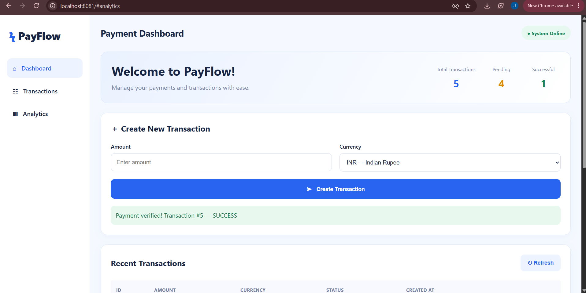

# PayFlow — Payment Application

A Java-based payment application built with **Spring Boot, MySQL, and Razorpay**. PayFlow provides REST APIs for creating payment orders, verifying payment signatures, and managing transaction records, along with a web dashboard for interacting with the application.

> **Project status:** Academic / portfolio project. Razorpay integration should be tested using test-mode credentials before any live deployment.

## 📸 Application Screenshots

Add three screenshots of your actual application in the `screenshots` folder.

### 1. PayFlow Dashboard



### 2. Create Payment / Payment Flow


### 3. Transaction Details / API Response


*Replace these image files with screenshots captured from your running application. The images will appear here once the files are added to the repository.*

---

## 📌 Table of Contents

- [Overview](#-overview)
- [Features](#-features)
- [Technologies Used](#-technologies-used)
- [How PayFlow Works](#-how-payflow-works)
- [Project Structure](#-project-structure)
- [REST API Endpoints](#-rest-api-endpoints)
- [Database](#-database)
- [Prerequisites](#-prerequisites)
- [Installation and Setup](#-installation-and-setup)
- [Running the Application](#-running-the-application)
- [Testing the APIs](#-testing-the-apis)
- [Configuration and Security](#-configuration-and-security)
- [Future Enhancements](#-future-enhancements)
- [Author](#-author)

## 🚀 Overview

PayFlow is a backend-focused payment application developed to demonstrate how a Java Spring Boot application can integrate with a relational database and a payment gateway.

The application connects a web interface with REST API endpoints. Payment orders can be created through Razorpay, payment verification can be performed using a signature, and transaction information can be stored in MySQL.

The project demonstrates REST API development, database connectivity, backend application configuration, and third-party payment gateway integration.

## ✨ Features

- **Payment order creation:** Create a payment order through the backend API.
- **Payment verification:** Verify payment signatures using the Razorpay integration.
- **Transaction management:** Retrieve transaction records through the transaction API.
- **MySQL integration:** Store application transaction data in a relational database.
- **Spring Data JPA:** Manage database entities and persistence.
- **Web interface:** Use the application's static HTML dashboard.
- **RESTful architecture:** Expose HTTP endpoints for frontend-backend communication.
- **Environment-based configuration:** Read database and Razorpay credentials from environment variables.
- **Local development:** Run the backend locally using the Maven wrapper.

## 🛠️ Technologies Used

| Technology | Purpose |
|---|---|
| Java 21 | Core programming language |
| Spring Boot | Backend application framework |
| Spring Web | REST API development |
| Spring Data JPA | Database persistence |
| Hibernate | ORM and entity management |
| MySQL 8 | Relational database |
| Maven Wrapper | Build and dependency management |
| Razorpay | Payment gateway integration |
| HTML | Web page structure |
| CSS | Web page styling |
| JavaScript | Frontend interactions |
| Git and GitHub | Version control and project hosting |
| VS Code | Development environment |

## 🔄 How PayFlow Works

The general payment flow is:

1. The user opens the PayFlow web interface.
2. The frontend sends a request to the Spring Boot backend to create a payment order.
3. The backend communicates with Razorpay using the configured API credentials.
4. The returned order information can be used by the frontend to continue the payment process.
5. After payment, the frontend sends the relevant payment details to the verification endpoint.
6. The backend verifies the payment signature.
7. Transaction information can be managed through the application's database and transaction API.

**Architecture overview**

```text
User
  |
  v
PayFlow Web Interface
(HTML, CSS, JavaScript)
  |
  v
Spring Boot REST API
  |
  +--------------------+
  |                    |
  v                    v
Razorpay API        MySQL Database
  |
  v
Payment Response
  |
  v
Backend Verification
```

*Note: This is a high-level representation. The exact transaction status updates and persistence behavior depend on the implemented service and controller logic.*

## 📂 Project Structure

The following is a guide to the main files and folders in the project. The exact Java package and class names may differ in your local source code.

```text
payflow/
│
├── .mvn/
│   └── wrapper/
│
├── src/
│   └── main/
│       ├── java/
│       │   └── <your-package>/
│       │       ├── controller/
│       │       ├── service/
│       │       ├── repository/
│       │       ├── entity/
│       │       └── config/
│       │
│       └── resources/
│           ├── static/
│           │   └── index.html
│           └── application.properties
│
├── screenshots/
│   ├── s1.png
│   ├── s2.png
│   └── s3.png
│
├── .gitignore
├── mvnw
├── mvnw.cmd
├── pom.xml
└── README.md
```

### Folder and file descriptions

- `src/main/java/` — Java source code for the backend.
- `controller/` — Handles HTTP requests and API responses, if organized as a separate package.
- `service/` — Contains business logic, if implemented as a separate package.
- `repository/` — Database access using Spring Data JPA, if implemented as a separate package.
- `entity/` — Entity classes representing database records, if implemented as a separate package.
- `config/` — Application configuration classes, if present.
- `src/main/resources/static/` — Static web resources, including the application's `index.html`.
- `application.properties` — Application port, database connection settings, and Razorpay configuration.
- `pom.xml` — Maven project configuration and dependencies.
- `mvnw` and `mvnw.cmd` — Maven wrapper scripts for Linux/macOS and Windows.
- `screenshots/` — Images displayed in this README.
- `.gitignore` — Excludes files that should not be tracked by Git.

## 🌐 REST API Endpoints

The following endpoints are the main API routes configured for this project.

| Method | Endpoint | Purpose |
|---|---|---|
| `GET` | `/api/transactions` | Retrieve transaction records |
| `POST` | `/api/payments/create-order` | Create a payment order |
| `POST` | `/api/payments/verify` | Verify payment details and signature |

### 1. Get Transactions

**Request**

```http
GET http://localhost:8081/api/transactions
```

**Purpose:** Requests transaction records from the backend.

### 2. Create Payment Order

**Request**

```http
POST http://localhost:8081/api/payments/create-order
```

**Purpose:** Requests the backend to create a Razorpay payment order.

The required request body and response format depend on the controller implementation.

### 3. Verify Payment

**Request**

```http
POST http://localhost:8081/api/payments/verify
```

**Purpose:** Sends payment-related information to the backend for signature verification.

Use the exact request fields expected by your implementation. A successful API request should not be treated as proof of a completed payment unless the backend confirms the verification result.

## 🗄️ Database

PayFlow uses **MySQL 8** with the database name:

```text
payflow_db
```

The application connects to MySQL through Spring Boot datasource configuration and uses Spring Data JPA/Hibernate for persistence.

### Database configuration

The database connection is configured in:

```text
src/main/resources/application.properties
```

Example:

```properties
spring.datasource.url=jdbc:mysql://localhost:3306/payflow_db
spring.datasource.username=root
spring.datasource.password=${DB_PASSWORD}

spring.jpa.hibernate.ddl-auto=update
spring.jpa.show-sql=true
spring.jpa.properties.hibernate.format_sql=true
```

Hibernate's `update` setting can update the database schema based on mapped entities. Review the schema and use an appropriate migration strategy before production deployment.

## ⚙️ Prerequisites

Install the following before running the project:

- Java Development Kit (JDK) 21
- MySQL Server 8.x
- Git
- Visual Studio Code or another Java-compatible IDE
- A Razorpay account with test-mode API credentials

Verify Java installation:

```powershell
java -version
javac -version
```

## 💻 Installation and Setup

### Step 1: Clone the repository

```bash
git clone https://github.com/janhavi9669-hub/PayFlow.git
cd PayFlow
```

### Step 2: Create the MySQL database

Open MySQL and execute:

```sql
CREATE DATABASE payflow_db;
```

Ensure that the MySQL server is running on port `3306`, or update the datasource URL to match your configuration.

### Step 3: Configure environment variables

The application expects these environment variables:

```text
DB_PASSWORD
RAZORPAY_KEY_ID
RAZORPAY_KEY_SECRET
```

On Windows PowerShell, set them in the terminal that you will use to run the application:

```powershell
$env:DB_PASSWORD = Read-Host "MySQL root password"
$env:RAZORPAY_KEY_ID = Read-Host "Razorpay Test Key ID"
$secure = Read-Host "Razorpay Test Key Secret" -AsSecureString
$env:RAZORPAY_KEY_SECRET = [System.Net.NetworkCredential]::new("", $secure).Password
```

Use the password for the MySQL account configured in `application.properties`. For Razorpay, use your own **test-mode** key ID and secret from the Razorpay Dashboard.

These variables are temporary for the current PowerShell session. Set them again in a new terminal when needed.

### Step 4: Check application configuration

Make sure `src/main/resources/application.properties` contains the following settings:

```properties
spring.application.name=payflow
server.port=8081

spring.datasource.url=jdbc:mysql://localhost:3306/payflow_db
spring.datasource.username=root
spring.datasource.password=${DB_PASSWORD}

spring.jpa.hibernate.ddl-auto=update
spring.jpa.show-sql=true
spring.jpa.properties.hibernate.format_sql=true

razorpay.key.id=${RAZORPAY_KEY_ID}
razorpay.key.secret=${RAZORPAY_KEY_SECRET}
```

### Step 5: Build the application

On Windows, run:

```powershell
.\mvnw.cmd clean package
```

This downloads required dependencies and builds the project.

## ▶️ Running the Application

Start the application from the project root:

```powershell
.\mvnw.cmd spring-boot:run
```

Once the application starts successfully, open:

```text
http://localhost:8081
```

The main static page is located at:

```text
src/main/resources/static/index.html
```

If the application fails to start, check that MySQL is running and that all three environment variables are set in the same terminal session.

## 🧪 Testing the APIs

You can test the endpoints using Postman, a REST client, or another HTTP testing tool.

Suggested checks:

1. Confirm that the backend starts successfully.
2. Send a `GET` request to `/api/transactions`.
3. Send a `POST` request to `/api/payments/create-order` using the request format expected by the controller.
4. Test `/api/payments/verify` with valid payment details generated through the test payment flow.
5. Check the backend logs and database to confirm the resulting behavior.

Use Razorpay test mode and test payment credentials during development. Never use real customer payment details for local testing.

## 🔐 Configuration and Security

- Never commit API secrets, database passwords, or `.env` files to GitHub.
- Keep the real credentials in environment variables or an appropriate secret manager.
- Use Razorpay test credentials during development.
- Do not expose the Razorpay secret key in frontend HTML or JavaScript.
- Validate payment signatures on the backend.
- Use HTTPS, appropriate authentication, authorization, validation, and production-safe error handling before deployment.
- Avoid relying on frontend responses alone to determine whether a payment is successful.
- Review logs to ensure that secrets and sensitive payment information are not printed.

## 🚧 Future Enhancements

Potential improvements for future versions include:

- Improved dashboard UI and responsive design.
- Detailed transaction history and status indicators.
- Better input validation and error messages.
- Automated unit and integration tests.
- Pagination and filtering for transaction records.
- Payment status reconciliation and webhook handling.
- Secure authentication and authorization.
- Deployment with production environment configuration.

These are potential enhancements, not claims that they are already implemented.

## 👩‍💻 Author

**Janhavi Chavan**

- GitHub: [janhavi9669-hub](https://github.com/janhavi9669-hub)
- Project Repository: [PayFlow](https://github.com/janhavi9669-hub/PayFlow)

---

⭐ If you find this project useful, consider starring the repository.

*Built as a learning project to explore Java backend development, REST APIs, relational databases, and payment gateway integration.*